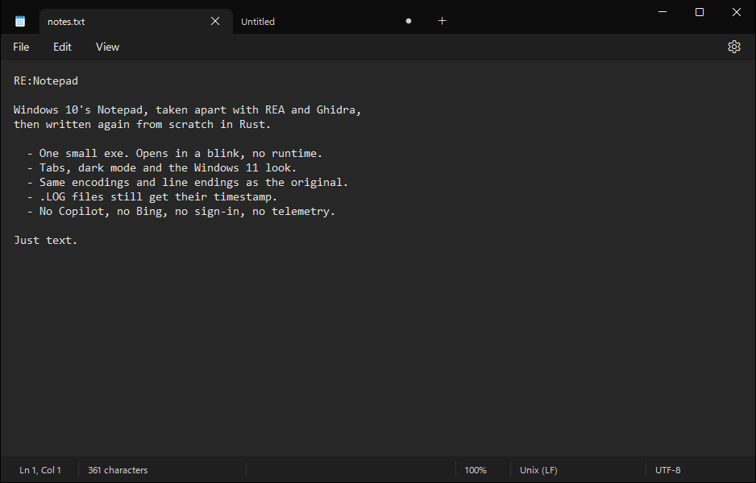
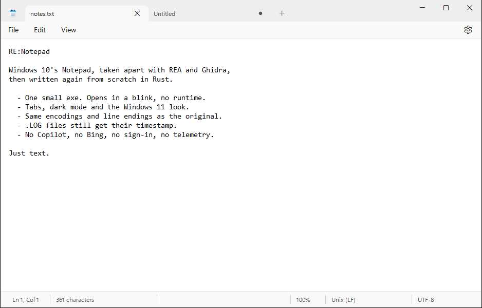
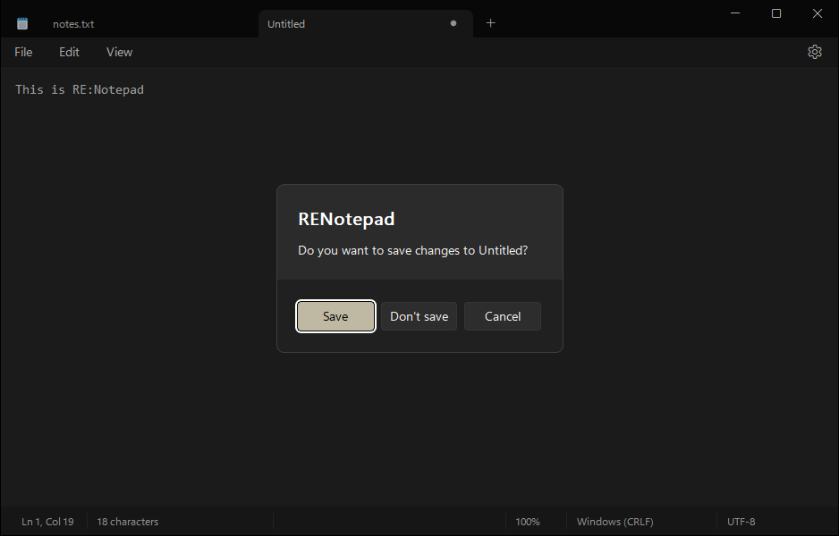
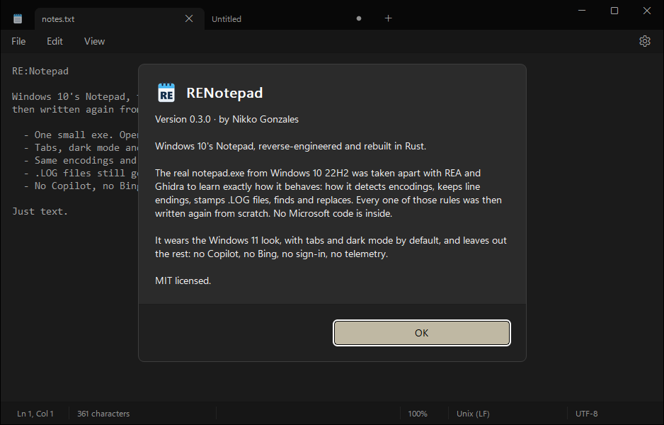

<div align="center">


# RE:Notepad

**Windows 10's Notepad, reverse-engineered and rebuilt in Rust, wearing Windows 11's look.**
Dark by default. No Copilot, no Bing, no sign-in, no telemetry. Just text.

[**Download**](https://github.com/nikkoxgonzales/RENotepad/releases/latest) ·
[The story](#the-story) ·
[Make it your default](#make-it-your-default) ·
[Build from source](#build-from-source)



</div>

## The story

Notepad used to be the one program on Windows that never changed. You opened
it, you typed, you closed it. Windows 11's Notepad looks great, but it has
picked up Copilot, a Bing search button, sign-in prompts and a formatting
toolbar. Windows 10's Notepad still just edited text, but it looks its age.

I wanted both: the old Notepad's behavior with the new Notepad's looks.

So I took the real thing apart. I downloaded `notepad.exe` from Windows 10
22H2 (version 10.0.19041.5856) straight from Microsoft's symbol server, opened it in
[Ghidra](https://ghidra-sre.org/) through [REA](https://github.com/morluto/rea),
and read how it actually works. A few of the things I found:

- **How it guesses an encoding.** It checks for a byte-order mark, then asks
  Windows' `IsTextUnicode`, with a special guard for files under 100 bytes.
  That guard is the fix for the famous "Bush hid the facts" bug. Then it tries
  strict UTF-8, and falls back to ANSI.
- **How it keeps line endings.** Since 2018 Notepad keeps Windows (CRLF), Unix
  (LF) and old Mac (CR) line endings exactly as they are, even mixed in one file.
- **The `.LOG` trick.** A file whose first line is `.LOG` gets a timestamp
  appended every time you open it, so it works as a diary.
- **Find, Replace, Go To,** word wrap, zoom, printing: all the small rules.

I wrote every rule down in plain words in
[docs/WIN10-NOTEPAD-SPEC.md](docs/WIN10-NOTEPAD-SPEC.md), with the function in
the binary each one came from. Then I wrote the app again from that spec, from
scratch, in Rust. The binary was studied, not copied: no Microsoft code is
inside.

Then came the Windows 11 look. I measured Windows 11 Notepad from screenshots,
pixel by pixel, and rebuilt it by hand:
- the tabs in the title bar;
- the flat menu bar with the settings gear;
- the status bar;
- the 16 px text margin;
- the rounded dialogs with the button in your accent color.

It's all plain Win32 and GDI, so the whole app is a single exe of about 350 KB
that opens instantly.

The **RE** stands for **r**everse **e**ngineering. The app itself is called
**RENotepad**, because a colon can't go in a file name.

| Light mode | Windows 11 dialogs |
|---|---|
|  |  |

## Download

Get it from the [latest release](https://github.com/nikkoxgonzales/RENotepad/releases/latest):

- **Installer** (`RENotepad-x.y.z-setup.exe`), recommended. It installs for your
  user account (no admin needed; it can install for all users too) and
  registers RENotepad with Windows, so it shows up in *Open with* and in
  *Settings › Default apps*. It also adds a Start menu entry and an uninstaller.
- **Portable** (`RENotepad-x.y.z-portable.zip`). Unzip it anywhere and run
  `RENotepad.exe`. Nothing is installed. Settings are still kept in the
  registry (`HKCU\Software\RENotepad`), the same way Windows' Notepad does it.

Needs Windows 10 or 11, 64-bit. The files aren't code-signed yet, so
SmartScreen may warn the first time: choose *More info › Run anyway*. Each
release has a `SHA256SUMS.txt` you can check the downloads against.

## Make it your default

Windows doesn't let any installer make itself the default app; you choose. After installing:

1. **For all text files at once:** open *Settings › Apps › Default apps*,
   search for **RENotepad**, and pick it for the file types you want
   (`.txt`, `.log`, `.ini`, `.md`, `.json`, `.csv`…). The installer's last page
   has a checkbox that opens this page for you.
2. **For one file type:** right-click a file, then *Open with › Choose another
   app*. Pick **RENotepad** and tick *Always*.

The installer can also add **Edit with RENotepad** to every file's right-click
menu. On Windows 11 it's under *Show more options*.

### Bring your pinned files

The files you pinned to Notepad's taskbar jump list (right-click Notepad on the
taskbar) can come along. The installer offers it the first time you install.
Afterwards, *Settings › Import pinned files from Notepad* does it any time.
It reads Windows 11's Notepad, and also Windows 10's classic Notepad, though
that's untested so far. If Windows refuses, the import says so. Notepad keeps
its own pins; RENotepad only reads them. Pins to files that no longer exist
(moved or deleted since you pinned them) are skipped, and the import tells you
how many.

RENotepad's own jump list works like Notepad's. Files you open show up under
*Recent*, and you can pin any of them. Recent stays empty while Windows'
"Show recently opened items in Start, Jump Lists, and File Explorer" setting is
off; pinned files stay either way. To pin the file you have open, use
*File › Pin to jump list*: it works whatever that setting is.

## What it does

It's the classic Notepad, minus the extras.

- **Look:**
  - The Windows 11 style: icon and tabs in the title bar, a flat File / Edit /
    View menu bar, a settings gear.
  - Dark mode by default, light mode one click away.
  - Text inset 16 px from the edges, and scrollbars only when there's
    something to scroll.
  - Prompts, Go to line and About are Windows 11 style dialogs over the
    dimmed window, with the main button in your accent color.
- **Tabs:**
  - Ctrl+N or Ctrl+T opens one; Ctrl+W, middle-click or the × closes one.
  - Ctrl+Tab / Ctrl+Shift+Tab (or Ctrl+PgDn / Ctrl+PgUp) switch between them.
  - A dot on a tab means unsaved changes.
  - Opening a file that's already open switches to its tab.
- **File:** New tab, New window, Open, Save, Save as (with an Encoding picker),
  Save all, Page setup, Print, Close tab, Close window.
- **Edit:** Undo, Cut, Copy, Paste, Delete, Find, Find next/previous
  (F3 / Shift+F3), Replace, Go to, Select all, Time/Date (F5), Font.
- **View:** Zoom (Ctrl+Plus / Ctrl+Minus / Ctrl+0 / Ctrl+wheel), Status bar,
  Word wrap.
- **Status bar:**
  - Line and column, then the character count ("5 of 120 characters" while
    text is selected).
  - Zoom, line endings and encoding on the right.
- **Encodings:** ANSI, UTF-8, UTF-8 with BOM, UTF-16 LE/BE, detected the way
  Windows 10 does it. Line endings are kept as they are.
- **`.LOG` files** get a timestamp each time they're opened.
- **Command line:** `RENotepad [/A|/W] [file]`, or `RENotepad /P file` to print
  to the default printer.



## Updates and privacy

RENotepad never sends anything about you or your files anywhere. Its one
network request is the update check:
- What it sends: a single HTTPS request to GitHub's public API asking for this
  project's latest release. The request carries no data except the app's name
  and version.
- When it runs: at startup, in the background.
- What you see: a short notice in the status bar only when a newer version
  exists. Click the notice, or use *Settings › Check for updates*, to see the
  details and the download link.
- How to turn it off: *Settings › Check for updates at startup*.

RENotepad never downloads or installs anything by itself.

## Build from source

You need the Rust MSVC toolchain and the Windows SDK, which provides `rc.exe`
for the icon and version info.

```sh
cargo build --release          # target\release\RENotepad.exe
cargo test                     # encoding, find/replace, .LOG, command line, version checks
pwsh scripts/package.ps1       # dist\: installer, portable zip, SHA256SUMS.txt
```

`package.ps1` downloads a pinned, hash-checked [Inno Setup](https://jrsoftware.org/isinfo.php)
into `.tools\` the first time it runs, in portable mode, so nothing is
installed system-wide. Pushing a version tag (`v0.3.0`) makes GitHub Actions
run the same script and publish the release.

**UI tests.** `tests/ui/` drives the real exe through window messages without
ever taking your keyboard or covering your screen. See
[tests/ui/README.md](tests/ui/README.md).

```sh
pwsh tests/ui/smoke.ps1     # find/replace/go to, dialogs, layout, tabs, settings
pwsh tests/ui/menus.ps1     # menu bar keyboard navigation
pwsh tests/ui/update.ps1    # update check (needs the internet)
pwsh tests/ui/pins.ps1      # importing Notepad's pins (on made-up jump lists only)
pwsh tests/ui/installer.ps1 # install, reinstall, uninstall (only if not installed)
```

## Known limits

- **Find and Replace** open as a small dialog, the Windows 10 way, rather than
  Windows 11's bar inside the window.
- **Font dialog:** only partly dark, because Windows draws its font lists itself.
- **Open/Save dialog:** follows the system theme, not the app's.
- **Page Setup:** the header and footer are fixed (file name / `Page N`).
- **Character count:** in documents that mix line-ending types, it can be off
  by the number of mixed line breaks.
- **Screen readers** read the Windows 11 dialogs' titles but not their
  buttons, which are drawn by the app. The keyboard works fully: Tab, arrows,
  Enter, Esc, and Alt+letter.
- **On Windows 10** the window has no 1-pixel border along its top edge.
- **Importing Notepad's pins** uses the jump list interface Explorer itself uses,
  which Microsoft doesn't document. If a Windows update changes it, the import
  says it couldn't, and the editor is unaffected.
- **Portable copy:** Windows shows jump list entries only for file types the app
  is registered for, which the installer does. A portable copy's jump list may
  stay empty.
- **Left out on purpose:** the formatting toolbar, Copilot, spell check and
  session restore.

## Project layout

- `src/main.rs`: entry point and message loop.
- `src/app.rs`: main window, tabs, menus and commands.
- `src/chrome.rs`: the Windows 11 title bar and menu bar.
- `src/status.rs`: the status bar.
- `src/content_dialog.rs`: the Windows 11 dialog (card, accent button, dimmed
  owner).
- `src/dialogs.rs`: Find/Replace, the message box, Go to line, About.
- `src/update.rs`: the update check.
- `src/jumplist.rs`: the taskbar identity and the pin import from Notepad.
- `src/encoding.rs`, `src/text.rs`: the pure rules, unit-tested.
- `src/theme.rs`: dark and light palettes and drawing helpers.
- `src/print.rs`, `src/filedlg.rs`, `src/settings.rs`.
- `assets/`: the icon, plus `make_icon.py`, which draws it (needs Pillow).
- `installer/RENotepad.iss`: the Inno Setup installer.
- `scripts/package.ps1`: builds the release assets.
- `docs/WIN10-NOTEPAD-SPEC.md`: the behavior spec, with the reverse-engineering
  evidence.
- `re/`: the script that drove REA.
- `tests/ui/`: the focus-free UI tests.

## Credits

- [REA](https://github.com/morluto/rea) and [Ghidra](https://ghidra-sre.org/) for the reverse engineering.
- [Inno Setup](https://jrsoftware.org/isinfo.php) for the installer.
- Microsoft, for twenty-odd years of Notepad. RE:Notepad is an independent
  project, not affiliated with or endorsed by Microsoft. Windows and Notepad
  are trademarks of Microsoft Corporation.

## License

[MIT](LICENSE) © 2026 Nikko Gonzales

## Changelog

<!-- Newest on top. Format: `YYYY-MM-DD — version: what changed`. -->

- 2026-10-13 — 0.4.0:
  - Brings over the files pinned to Notepad's taskbar jump list: offered by the
    installer, and *Settings › Import pinned files from Notepad*. Pins to files
    that no longer exist are skipped.
  - *File › Pin to jump list* pins the open file, even with Windows' recent
    items turned off.
  - RENotepad has its own taskbar identity, so its jump list stays the same
    across updates. If you pinned 0.3.0 to the taskbar, unpin it and pin it again.
- 2026-10-13 — 0.3.0:
  - Checks GitHub for a newer version at startup and shows a notice in the
    status bar; *Settings › Check for updates* does it on demand.
  - Installer and portable zip.
  - Windows 11 style dialogs for prompts, Go to line and About.
- 2026-10-13 — 0.2.0: renamed RE:Notepad. Windows 11 look (title bar with tabs,
  flat menu bar, settings gear, status bar with character count), tabs, Save
  all, its own icon, an About box with the story.
- 2026-10-13 — 0.1.0: the full Windows 10 Notepad feature set, dark mode by default.
